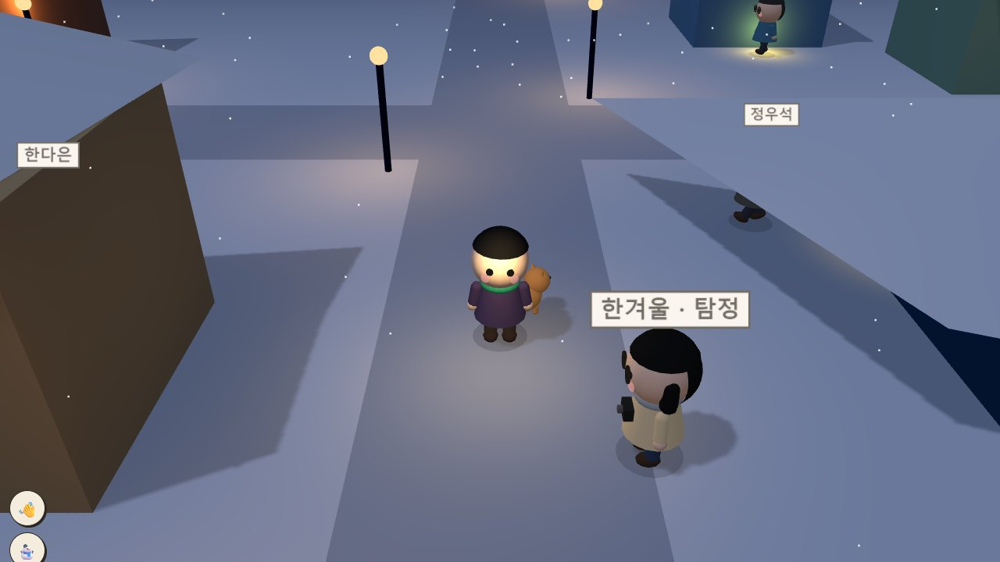

# Nunmaeul (눈마을)

**A free 3D mystery game for Windows, set in a small snowy village.** Walk around as a detective, pick up clues, tail the suspects, catch the moment on camera and name the culprit — while other players on the same case walk the village with you. The game is in Korean.

**Install:** download `Nunmaeul.exe` from [Releases](https://github.com/swbins/nunmaeul/releases/latest) (Windows 10/11, single file, no installer).

[한국어 설명 ↓](#한국어)

---

## 한국어

**눈마을 — 눈 내리는 3D 마을의 추리 게임**

작은 눈마을을 탐정이 되어 걸어 다니며 단서를 줍고, 주민과 이야기하고, 미행하고, 결정적 순간을 사진으로 잡아 범인을 찍습니다.

- 사건 여섯 개 — 눈길 뺑소니, 창고 방화, 잔치 국솥, 꺼진 가로등, 멈춘 리프트, 마을 계좌. 마을 시계가 흐르고 용의자는 제 갈 길을 다닙니다.
- 고양이 도토리가 단서 근처에서 냄새를 맡습니다.
- 같은 사건을 하는 다른 사람들이 마을에서 서로 보입니다. 손 흔들기 · 눈싸움 · 사진 단추.

사람도 마을도 사건도 다 지어낸 이야기입니다.

## 받기

**[최신 판 받기 (Releases)](https://github.com/swbins/nunmaeul/releases/latest)** — `Nunmaeul.exe` 하나, 설치 과정 없음

- **Windows 10 / 11** (창은 Microsoft Edge 로 열립니다 — 기본으로 깔려 있음)
- 처음 실행할 때 **「Windows의 PC 보호」** 창이 뜰 수 있습니다. 코드 서명을 하지 않은 개인 앱이라 그렇습니다.
  **「추가 정보」 → 「실행」** 을 누르면 열립니다.
- 받은 파일 확인(PowerShell): `Get-FileHash .\Nunmaeul.exe` → 릴리스 노트의 SHA256 과 같으면 그대로 받은 것입니다.

## 저장 · 인터넷

- 진행 기록은 **이 PC 안**(`%LOCALAPPDATA%\Nunmaeul`)에만 남습니다. 가입 · 로그인 · 광고 · 사용 통계가 없습니다.
- 인터넷을 쓰는 건 두 가지입니다.
  - **같이 걷기** — 별명(자동으로 붙는 「졸린 외투」 같은 이름) · 모습 색 · 마을 안 위치 · 손 흔들기 같은 동작만 보냅니다. 끊겨 있으면 혼자 모드로 그대로 됩니다.
  - **내용 업데이트** — 켤 때 사이트(swbins.github.io)에서 새 사건 · 고친 내용을 확인해 **바뀐 파일만** 받아 둡니다. 다음에 켤 때부터 새 내용이 보입니다.
- 자세한 것은 [개인정보 처리 안내](PRIVACY.md). 지우려면 실행 파일과 위 폴더를 지우면 됩니다.

- [이용 약관](TERMS.md)
- [서드파티 고지](THIRD-PARTY-NOTICES.md)

## 문의 · 버그 알리기

[Issues](https://github.com/swbins/nunmaeul/issues) 에 남겨 주세요. 소개 페이지: https://swbins.github.io/nunmaeul/

---

이 저장소에는 실행 파일과 안내 문서만 있습니다(소스 비공개).
